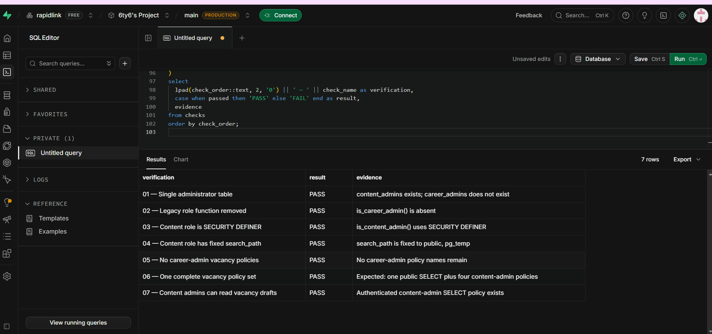
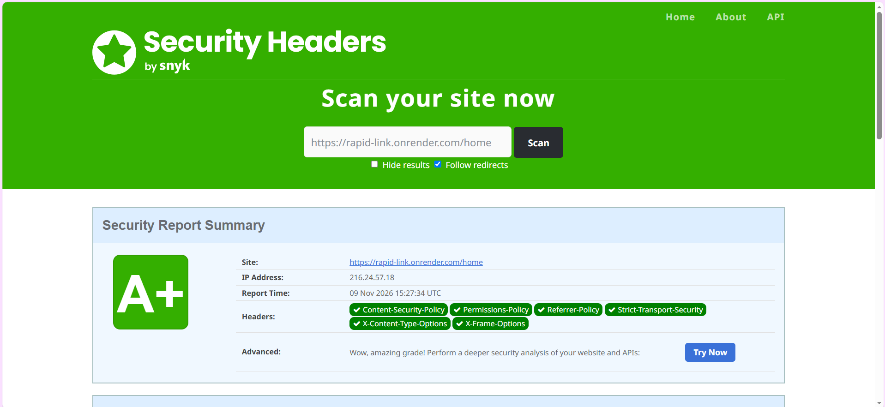
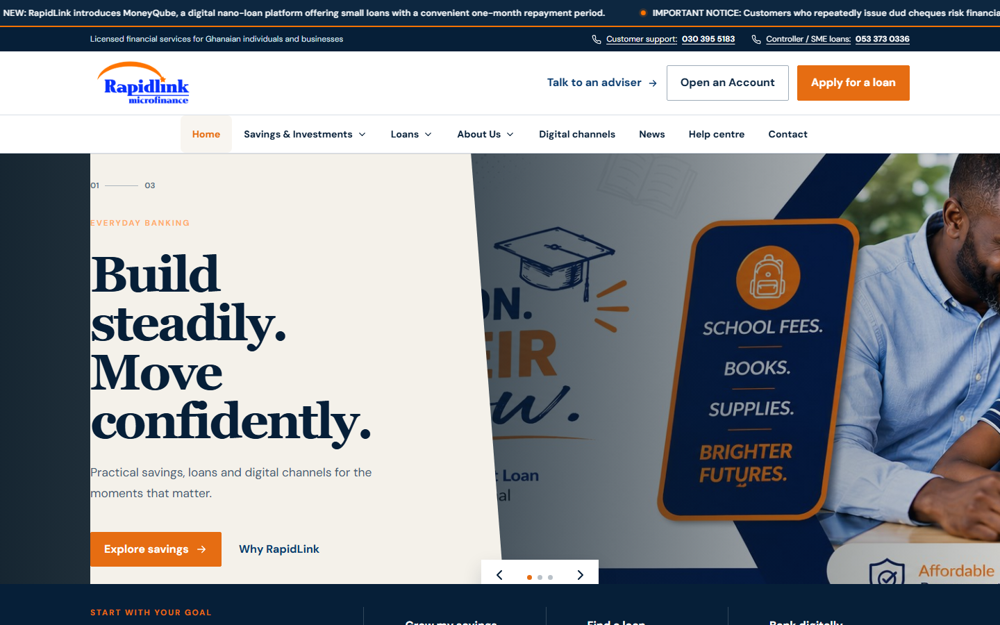
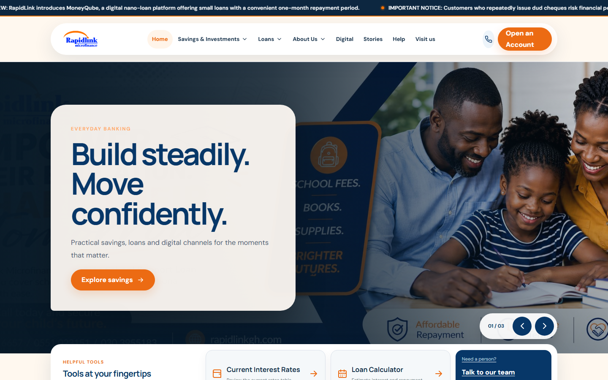
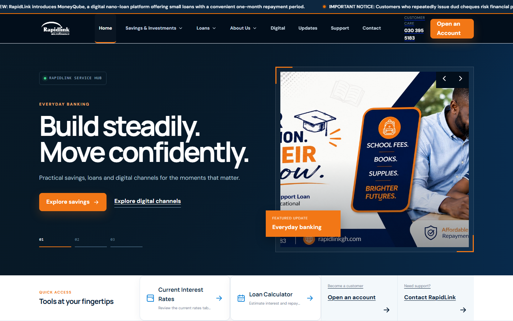
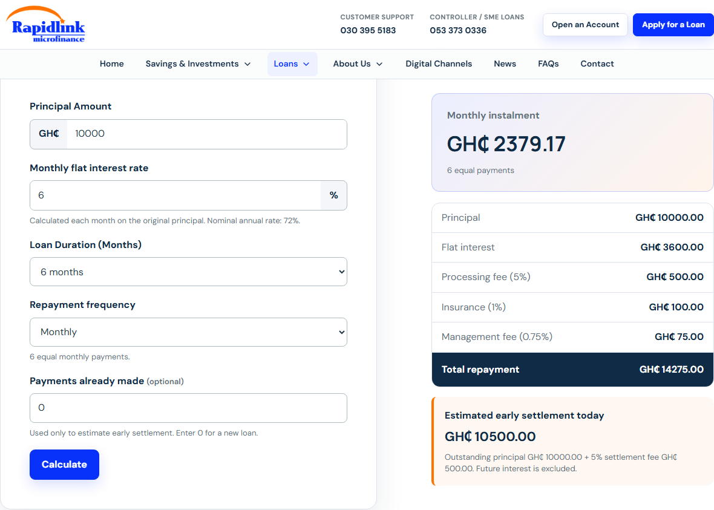
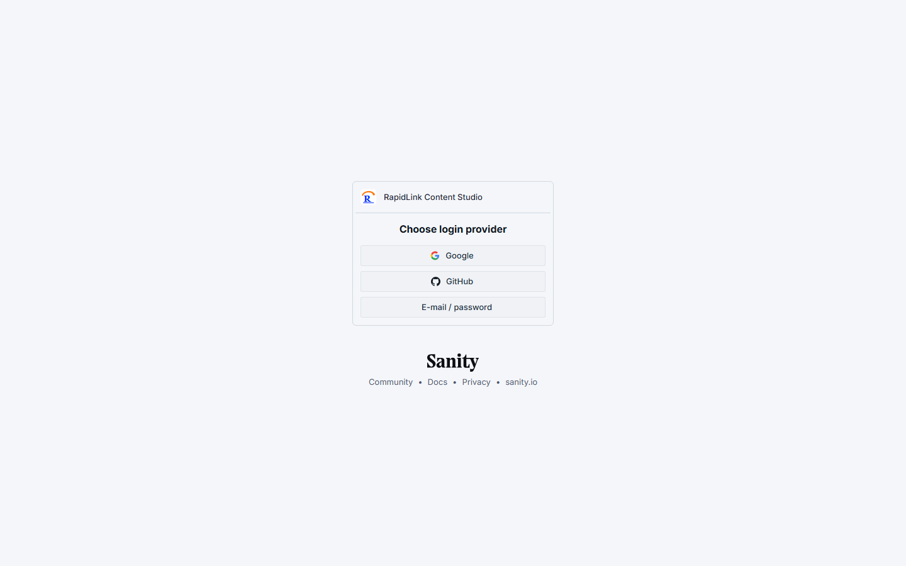
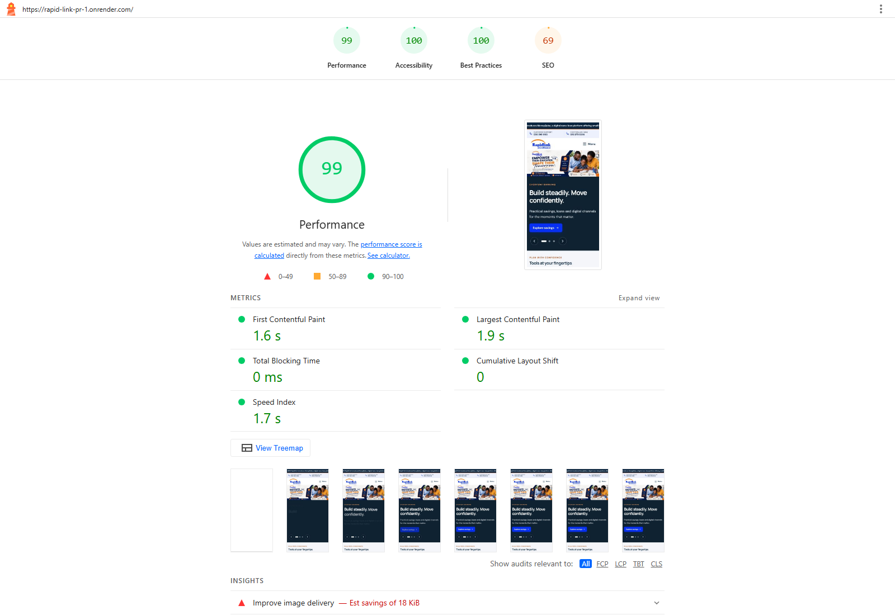

# RapidLink Website Current Implementation and CMS Evaluation Report

**Submitted to:** Edmund Nii Odoi Akogyeram, IT Officer  
**Prepared by:** Caleb Adom Awuah  
**Report date:** 19 November 2026  
**Project:** RapidLink Microfinance Website Redesign, Content Management and Customer-Service Improvement  
**Document status:** Management progress report, verification brief and CMS decision paper  
**Current development branch:** `cms-evaluation/sanity`  
**Production branch:** `main`  
**Confirmed production domain:** `rapidlinkgh.com`

<!-- pagebreak -->

# Table of Contents

[[TOC]]

<!-- pagebreak -->

# 1. Executive Summary

This report records the current position of the RapidLink website project as at 19 November 2026. It consolidates the completed frontend, backend, security, loan-calculator and content-management work; presents the three alternative frontend concepts prepared for management selection; and compares the three content management systems shortlisted for practical evaluation: Directus, Sanity and Strapi.

The project has progressed beyond a visual prototype. It now contains a structured content-access layer, protected content administration, hosted security controls, genuine HTTP 404 handling, route pre-rendering, responsive navigation, controlled external links, editable announcements and institutional information, and a working loan calculator. Experimental work remains isolated from `main`, so the current production baseline is not changed until management approves a frontend direction and a production content-management approach.

Three distinct frontend concepts were completed on separate branches: **Corporate Trust**, **Human-Centred** and **Digital First**. Each concept retains the same RapidLink information, product routes and brand colours, but uses a different navigation model, homepage composition, content hierarchy, slider treatment and footer. Screenshots are included so management can select a direction before further page-by-page refinement.

The loan calculator is now functionally implemented using the information supplied during the current review period. It estimates flat interest, fees, repayment instalments and early settlement. The formula is protected in code, while selected figures and customer wording can be administered through Sanity. The current calculator record is intentionally marked **Provisional** because two operational items still require confirmation: the weekly schedule must be checked against Flexibank, and approved APR/customer-disclosure wording is not yet available. The calculator must not be presented as a binding quotation.

Sanity is the only shortlisted external CMS that has reached a substantial practical integration stage. Published news, vacancies, FAQs, impact counters, announcements, site information and calculator settings can be supplied to the React website through a token-free public read adapter. The Studio has RapidLink branding, an organised editorial menu and a protected calculator singleton. Existing content has been migrated with stable identifiers so repeat imports update records rather than duplicate them.

Directus was reviewed and a deployment path was prepared, but the attempted hosted evaluation requested payment. It was therefore not completed as a free practical trial. Strapi remains technically suitable for a future self-hosted comparison, but practical work was deliberately limited while the Sanity integration was being completed. A final CMS recommendation should be made only after ownership, security, workflow, support, backup, exit-cost and long-term operating-cost questions are scored consistently.

# 2. Project Purpose and Current Control Position

## 2.1 Purpose of the website

The website is intended to advertise RapidLink professionally while helping customers discover products, current information, contact channels, branch directions, approved digital services and financial-planning tools. It must remain understandable to customers, maintain the credibility expected of a regulated financial institution and provide a foundation for possible future transition into broader banking services.

## 2.2 Controlled development approach

The project uses separate Git branches and worktrees so that research and new designs do not alter the stable production branch.

| Branch | Purpose | Current position |
|---|---|---|
| `main` | Stable production baseline | Not changed by the current CMS evaluation |
| `cms-evaluation/sanity` | Sanity integration, content migrations and calculator configuration | Current active development branch |
| `design/corporate-trust` | Formal institutional frontend concept | Completed for management comparison |
| `design/human-centred` | Customer-goal-led frontend concept | Completed for management comparison |
| `design/digital-first` | Modular digital-service frontend concept | Completed for management comparison |

This approach permits a preview-first approval process. Only the approved frontend and CMS decisions should be merged toward `main`, retested and deployed to `rapidlinkgh.com`.

## 2.3 Information and approval boundaries

The implementation does not treat unverified financial or compliance information as approved. Content concerning loan pricing, complaints timeframes, fees, licensing, deposit protection, privacy, security advice and regulatory disclosures must be confirmed by the responsible department and Compliance before production publication.

# 3. Current Implementation Summary

## 3.1 Customer-facing frontend

The public React website provides responsive desktop and mobile layouts for products, news, careers, institutional information, digital channels, FAQs, contact information, maps and customer tools. Recent improvements include:

- consistent headers, dropdown behaviour and mobile navigation;
- safe external links that open separately from the website;
- a structured footer and social-media links using recognisable platform icons;
- branded image headers for principal information pages;
- an automatic announcement banner that remains readable and is not used as a misleading link;
- home-page links to current interest rates and the loan calculator;
- connected news summaries and detailed news pages;
- branch maps and directions;
- an improved branded 404 experience;
- page-specific metadata and social-preview images; and
- responsive image and page-layout improvements.

## 3.2 Content-access architecture

The frontend does not need to know whether a record came from local fallback content, Supabase or Sanity. It asks a stable repository for a known content contract. This reduces the cost of changing a CMS and keeps page design separate from content storage.

The current Sanity adapter covers:

- published news articles;
- published career vacancies;
- FAQs;
- institutional impact counters;
- announcements;
- site/contact information; and
- loan-calculator settings.

If the Sanity source is unavailable or a required singleton is inactive, the website retains reviewed local fallbacks instead of rendering an empty critical section.

## 3.3 Supabase security and protected content administration

Earlier Supabase content-management work established the security baseline that any replacement CMS must meet. The overlapping `career_admin` and `content_admin` models were consolidated into one authority model. The administrator function uses `SECURITY DEFINER` with a fixed search path, administrators can read drafts, and public users can read only published records.

Verification evidence records:

- seven of seven hosted consolidated-role checks passed;
- 36 of 36 local database security checks passed;
- 22 of 22 hosted public API checks passed using the publishable key;
- anonymous and signed-in non-administrator writes were rejected; and
- self-registration was disabled for the protected management workflow.

## 3.4 Search, social and deployment readiness

The production build pre-renders public routes so customers, search engines and social platforms receive useful HTML instead of an empty application shell. The project also includes canonical metadata, page descriptions, social images, a sitemap, a robots policy and genuine 404 output. Preview services should remain non-indexable until management approval.

The saved Render security audit received an A+ rating after the required response headers were configured. The final values must be rechecked after deployment on `rapidlinkgh.com` because a successful preview or Render-host result does not prove the final domain configuration automatically.

# 4. Frontend Design Options Awaiting Management Selection

## 4.1 Evaluation objective

Owura requested three genuinely different frontend directions rather than three colour variations of the existing site. The concepts therefore differ in structure, navigation, slider design, product presentation, footer layout and use of the RapidLink blue and orange palette. They retain the same underlying information so that management can judge the design rather than different content.

## 4.2 Option A: Corporate Trust

Corporate Trust presents RapidLink as a formal, established financial institution. It uses editorial spacing, disciplined alignment, prominent institutional messaging, structured product comparison and a formal information-rich footer.

**Advantages:** strong credibility, clear product comparison, suitable for formal corporate information and familiar to traditional banking customers.

**Risk to manage:** the layout can become dense if editors publish lengthy descriptions without content limits.

## 4.3 Option B: Human-Centred

Human-Centred organises the experience around customer goals and everyday needs. It uses approachable imagery, rounded content surfaces, simpler language hierarchy and guided choices for visitors who may not know a product name before arriving.

**Advantages:** approachable, easier for first-time customers, supports community-focused marketing and creates a warmer service experience.

**Risk to manage:** the friendly appearance must preserve sufficient institutional authority and text contrast.

## 4.4 Option C: Digital First

Digital First treats the website as a modern service hub. It uses compact navigation, modular cards, stronger contrast and direct access to rates, calculators, account opening and digital channels.

**Advantages:** efficient self-service, well suited to future banking functionality, easy to extend with additional digital services and visually contemporary.

**Risk to manage:** dense modules and small supporting labels require continued accessibility and mobile-usability testing.

## 4.5 Recommended selection process

Management should score the three concepts against brand fit, customer clarity, accessibility, speed of completing common tasks, credibility, marketing value, mobile usability, performance and maintainability. A single direction should then be selected before the remaining internal pages are refined. This avoids maintaining three complete websites and prevents repeated work.

# 5. Loan Calculator Implementation

## 5.1 Current functional scope

The calculator accepts a principal amount, duration, repayment frequency and optional number of payments already made. It then presents estimated interest, fees, total repayment, equal instalments and early-settlement amount.

The current provisional configuration is:

| Setting | Current value |
|---|---|
| Principal range | GH₵1,000 to GH₵20,000 |
| Duration | 1 to 6 months |
| Interest | 6% per month, flat on the original principal |
| Nominal annual rate | 72% |
| Processing fee | 5% of principal |
| Insurance | 1% of principal |
| Management fee | 0.75% of principal |
| Fee treatment | Added to total repayment |
| Repayment frequency | Weekly or monthly |
| Weekly schedule | 4, 8, 13, 17, 21 and 25 payments for months 1 to 6 |
| Early settlement | Outstanding principal plus 5% of outstanding principal |
| Future interest on early settlement | Excluded under the current stated assumption |

## 5.2 Worked example shown in the interface

For a GH₵10,000 principal over six months with monthly repayment, the current calculator estimates:

- flat interest of GH₵3,600;
- processing fee of GH₵500;
- insurance of GH₵100;
- management fee of GH₵75;
- total repayment of GH₵14,275; and
- six estimated monthly instalments of GH₵2,379.17.

## 5.3 Safety and governance design

The calculation formula and validation remain in version-controlled website code. Editors can change only approved settings and customer wording through the CMS. The Sanity calculator record is a singleton, preventing multiple conflicting records. It is divided into six numbered areas: loan limits, interest and fees, repayment schedule, early settlement, customer wording, and approval/dates.

The website uses the CMS settings only when a complete active record is available. Otherwise it uses the reviewed fallback. Every result is presented as an estimate and not as an approval or binding loan offer.

## 5.4 Remaining calculator confirmations

The calculator is technically complete but not ready to be represented as fully approved. The weekly schedule inferred from the supplied six-month/25-week example requires operational verification against Flexibank. Approved APR wording and three Flexibank comparison schedules were not available. These limitations are recorded in the CMS status and customer disclaimer rather than concealed.

# 6. CMS Evaluation Method

## 6.1 Why three systems were shortlisted

The project began with limited practical experience of full-scale external CMS products. To avoid selecting a platform based only on advertising, three strong but different options were shortlisted:

- **Directus** for a database-first and API-led model;
- **Sanity** for a hosted structured-content platform with a highly customisable Studio; and
- **Strapi** for an open-source, self-hosted Node.js CMS model.

The comparison considers editorial usability, structured content, workflow, access control, integration effort, hosting ownership, backup, security, vendor dependency, operating cost and exit options.

## 6.2 Pricing basis

All prices in this report are vendor-listed United States dollar prices checked on 19 November 2026. They may exclude tax, usage overages, infrastructure, support, implementation, migration and foreign-exchange costs. Vendor pricing can change and must be reconfirmed before procurement.

# 7. Directus Evaluation

## 7.1 How Directus would fit the website

Directus can sit over a SQL database and expose structured records through REST and GraphQL. It offers an administrative application, roles, permissions, workflows and file management. This is attractive where RapidLink wants stronger control over its database and API structure.

## 7.2 Work completed and test limitation

Directus was researched and a deployment path was considered. During practical setup, the selected hosted/deployment route requested payment for the required service resources. A free end-to-end trial was therefore not completed. This must be recorded as an evaluation limitation rather than evidence that Directus failed technically.

## 7.3 Current official pricing

Directus Cloud lists:

- **Core:** $89 per month when billed yearly, or $99 monthly; three seats, 25 collections and five flows;
- **Team:** $588 per month when billed yearly, or $698 monthly; ten SSO seats, 50 collections and 20 flows; and
- **Enterprise:** custom pricing.

The vendor advertises a 14-day Cloud trial. Directus also describes an Open Innovation Grant for qualifying individuals and small organisations that can make self-hosting free, subject to eligibility and licensing conditions.

## 7.4 Advantages and disadvantages for RapidLink

**Advantages:** database-first architecture, strong API model, granular permissions, flexible workflows and greater control when self-hosted.

**Disadvantages:** hosted entry price is materially higher than the other evaluated entry plans; self-hosting transfers patching, backup, monitoring and availability responsibility to RapidLink; and the practical staff workflow has not yet been validated in this project.

## 7.5 Directus conclusion

Directus remains a credible option if RapidLink prioritises database ownership and accepts the operational responsibility or hosted price. It cannot yet be recommended over Sanity because the attempted practical evaluation was not completed.

# 8. Sanity Evaluation and Current Integration

## 8.1 How Sanity is being used

Sanity stores structured content in its hosted Content Lake and provides an editable Studio built with React. The RapidLink website reads published data from the public CDN using native `fetch`; no secret management token is placed in the public website bundle.

The current Studio manages:

- news and uploaded article images;
- career vacancies and their publication status;
- ordered FAQs;
- institutional impact counters;
- announcement-banner messages;
- contact, branch and site information; and
- the controlled loan-calculator settings singleton.

The Studio navigation is grouped for editors, with all, visible/published and hidden/draft views. RapidLink branding, logo treatment and a calmer neutral theme have been applied so the interface is easier for staff to recognise and navigate.

## 8.2 Content migrations completed

Existing website and Supabase records have been migrated with stable document identifiers. Verified migration work includes news, career records, FAQs, impact counters, announcements, site settings and loan-calculator settings. Stable identifiers make the scripts repeatable: rerunning a migration updates the intended document instead of producing duplicate records.

The earlier news/career verification recorded five news articles, two career records and Sanity image references for all five news records. Public records require both a visible flag and publication; a saved draft alone does not appear on the website.

## 8.3 How Sanity works with the website

1. An authorised editor signs in to RapidLink Content Studio.
2. The editor creates or changes a structured record.
3. The editor confirms visibility and publishes the record.
4. The React adapter queries only published, visible records through Sanity's public CDN.
5. The adapter converts the response into the same content contract already used by the pages.
6. The website renders the new value without exposing an editorial token.
7. If critical CMS configuration is unavailable, the reviewed fallback protects the customer experience.

## 8.4 Current Growth trial/subscription position

The project is using the new-project Growth trial, which provides access to advanced Growth features for 30 days without requiring a credit card under Sanity's published trial terms. The trial supports evaluation of collaboration features such as additional roles, comments/tasks, scheduled drafts, AI Assist and private datasets. At the end of the trial, the project must either be upgraded or will be subject to Free-plan limits; it is not automatically evidence of an approved paid subscription.

## 8.5 Current official pricing

Sanity lists:

- **Free:** $0, up to 20 seats, two roles, two public datasets, 10,000 documents, 1 million CDN requests per month and 250,000 API requests per month;
- **Growth:** $15 per paid seat per month, up to 50 seats, five roles, two public or private datasets, 25,000 documents and collaboration features; and
- **Enterprise:** custom pricing, with custom roles, SSO, support, SLA and advanced controls.

Sanity also lists paid overages and add-ons. Examples include increased quota at $299 per month, dedicated support at $799 per month and an extra dataset at $999 per dataset per month. These are not currently approved project costs.

## 8.6 Advantages and disadvantages for RapidLink

**Advantages:** fastest completed integration, customisable editor interface, hosted delivery, structured schemas, image pipeline, good React fit, real-time editing and low entry cost for a small editorial team.

**Disadvantages:** hosted vendor dependency, per-seat Growth cost, usage/overage exposure after upgrading, Free-plan role limitations, and the need to define ownership and exit/export procedures before production adoption.

## 8.7 Sanity conclusion

Sanity currently has the strongest project-specific evidence because it has been connected, branded, populated, queried and tested. It is therefore the leading candidate for a controlled pilot, but not yet an unconditional production recommendation. RapidLink ownership, roles, backups/exports, approval workflow, billing limits and support arrangements must be agreed first.

# 9. Strapi Evaluation

## 9.1 How Strapi could fit the website

Strapi is an open-source Node.js headless CMS that can be self-hosted or run on Strapi Cloud. It provides content types, media, roles, REST/GraphQL APIs and a familiar administrative interface. It fits a team that prefers to own the application and database while retaining the option of vendor hosting.

## 9.2 Current test status

Strapi was shortlisted and researched, but it has not received the same practical integration depth as Sanity. Work remained focused on completing the Sanity schemas, migrations, frontend adapter and calculator configuration before starting another large integration. This is a resource and sequencing decision, not a finding that Strapi is unsuitable.

## 9.3 Current official Strapi Cloud pricing

Strapi lists monthly Cloud hosting prices of:

- **Starter:** $35 per project/month, 100,000 API requests, 50 GB asset storage and 50 GB bandwidth;
- **Pro:** $90 per project/month, 1 million API requests, 250 GB asset storage, 500 GB bandwidth, weekly backups and multi-environment support; and
- **Business:** $450 per project/month, 10 million API requests, 1,000 GB asset storage, 1,000 GB bandwidth, daily backups, two environments and a 99.9% SLA.

The vendor notes that local taxes may apply. Self-hosted community software can reduce the licence cost, but database, compute, storage, backup, monitoring, patching and staff time remain real operating costs.

## 9.4 Advantages and disadvantages for RapidLink

**Advantages:** open-source core, Node/React ecosystem fit, self-hosting option, conventional administration experience and stronger infrastructure control when operated internally.

**Disadvantages:** self-hosting creates maintenance and security responsibilities; Cloud hosting has a monthly project cost; and this project does not yet have completed migration, workflow, restore or staff-usability evidence.

## 9.5 Strapi conclusion

Strapi should remain the principal self-hosted comparison candidate. A small proof of concept should be built only if management needs a direct ownership-versus-hosted comparison after reviewing the Sanity pilot.

# 10. Side-by-Side CMS Comparison

| Criterion | Directus | Sanity | Strapi |
|---|---|---|---|
| Core model | Database-first data platform/CMS | Hosted structured-content platform | Open-source headless CMS |
| Practical project status | Research and deployment attempt; hosted route requested payment | Connected, branded, migrated and integrated | Researched; practical integration deferred |
| Lowest listed hosted price | $89/month yearly or $99 monthly | Free; Growth $15/paid seat/month | $35/project/month |
| Self-hosting | Yes, subject to licence/eligibility and operations | Studio can be hosted; content platform is vendor-hosted | Yes |
| React integration | Strong REST/GraphQL | Strong GROQ/CDN and React Studio | Strong REST/GraphQL |
| Current RapidLink evidence | Limited | Strongest | Limited |
| Infrastructure responsibility | Vendor on Cloud; RapidLink when self-hosted | Mostly vendor-hosted | Vendor on Cloud; RapidLink when self-hosted |
| Main concern | Cost or self-hosting burden | Vendor/usage dependency and role governance | Operational burden and unfinished test |
| Current position | Retain for comparison | Leading pilot candidate | Retain as self-hosted comparison |

## 10.1 Provisional recommendation

Continue the Sanity pilot because it has the strongest working evidence and lowest immediate integration risk. Do not make it the permanent production CMS until RapidLink confirms organisational ownership, editor roles, billing controls, export/restore procedure, support and a documented exit route. If infrastructure ownership is a deciding requirement, build a deliberately limited Strapi proof of concept and compare it against the same editorial tasks rather than beginning another full migration.

# 11. Verification and Evidence Position

## 11.1 Tests and builds

The current calculator and public-site tests passed, with 59 individual tests completing successfully. The website production build also completed and pre-rendered 26 public routes, and the Sanity Studio production build completed successfully.

One legacy compatibility test suite did not start because `src/services/content/index.js` contains an incorrect relative import path for the Sanity repository. This does not affect the successful production build because that compatibility module is not used by the public application, but it is a real repository defect and must be corrected before the branch is treated as fully green. Earlier evidence separately records successful public API and database-security verification. Before a production merge, the import defect must be resolved and the complete suite rerun on the selected frontend and final CMS configuration.

## 11.2 Performance and accessibility

The saved mobile Lighthouse evidence records performance 69, accessibility 91, best practices 92 and SEO 69. These figures were affected by the tested environment and remain a baseline rather than a final acceptance result. The selected frontend should receive fresh desktop and mobile audits without browser extensions, followed by image, script and metadata improvements.

## 11.3 Evidence limitations

- The Sanity image in this report shows the branded secure access gateway because automated capture does not reuse a staff login; authenticated functions are supported by implemented schemas, migration scripts and verification output.
- Directus and Strapi do not yet have equivalent end-to-end RapidLink evidence.
- The loan calculator has functional test evidence but still requires operational comparison against Flexibank.
- Vendor prices are current research values and not quotations.
- Final-domain security, metadata, social cards and 404 behaviour must be verified after deployment to `rapidlinkgh.com`.

# 12. Work Completed, Work Remaining and Decisions Required

## 12.1 Completed or substantially completed

- Three distinct frontend concepts built in isolated branches.
- Public content-access layer capable of switching sources.
- Supabase administrator-role consolidation and hosted security tests.
- Sanity Studio setup, RapidLink branding and organised editorial navigation.
- Sanity schemas and adapters for the current priority content groups.
- Migration of existing news, careers, FAQs, impact counters, announcements, site information and calculator configuration.
- Working loan calculator with validation, estimates and CMS-backed settings.
- Search/social metadata, pre-rendering, security headers and real 404 handling.
- Evidence archive for design, security and performance review.

## 12.2 Remaining technical and organisational work

- Select one frontend direction and complete only that branch.
- Correct the legacy compatibility-module import path and restore a fully passing repository test run.
- Obtain final Credit/Compliance approval for calculator disclosures and Flexibank schedules.
- Decide whether Sanity will be the pilot/production CMS or whether a limited Strapi proof is required.
- Transfer any selected hosted service into a RapidLink-owned organisation and billing arrangement.
- Define editor, approver, developer and viewer responsibilities.
- Document and test export, backup, restore and supplier-exit procedures.
- Complete the remaining public content types so all agreed website information is manageable without uncontrolled code editing.
- Obtain approved complaints procedure, fees schedule, security-centre information and licensing statement.
- Run final accessibility, performance, security, link, metadata, social-card and cross-browser acceptance tests.
- Deploy the approved branch to `rapidlinkgh.com` and perform post-deployment verification.

## 12.3 Decisions requested from Edmund and management

1. Select Corporate Trust, Human-Centred or Digital First as the frontend direction.
2. Approve continued Sanity pilot work or request a limited Strapi ownership comparison.
3. Confirm whether RapidLink requires self-hosting/AWS as a mandatory condition or only as an evaluated option.
4. Nominate the RapidLink owner for the CMS organisation, billing, access reviews and vendor relationship.
5. Confirm which roles may draft, review, publish and administer content.
6. Coordinate final calculator verification with Credit, Compliance and Flexibank operations.
7. Confirm the approved source and owner for complaints, fee, licensing and security-centre content.

# 13. Recommended Next Sequence

1. Management scores and selects one frontend concept.
2. Credit/Compliance verifies the calculator schedule, disclosure and approval status.
3. Conduct a short staff usability exercise in Sanity using news, vacancy, announcement and calculator tasks.
4. Decide whether Sanity evidence is sufficient or a limited Strapi proof is required.
5. Record CMS ownership, roles, costs, backup/export and exit decisions.
6. Complete the selected frontend and remaining approved content types.
7. Run full regression, accessibility, performance, security and user-acceptance testing.
8. Obtain written approval before merging toward `main`.
9. Deploy to `rapidlinkgh.com` and repeat final-domain verification.

# Appendix A. Official Pricing Sources Consulted

- Directus pricing: https://directus.com/pricing
- Sanity pricing: https://www.sanity.io/pricing
- Sanity Growth trial announcement: https://www.sanity.io/blog/introducing-new-sanity-growth-plan
- Sanity plan documentation: https://www.sanity.io/docs/platform-management/plans-and-payments
- Strapi Cloud pricing: https://strapi.io/pricing-cloud

# Appendix B. Principal Technical Records

- `docs/frontend-design-variants.md`
- `docs/sanity-evaluation-setup.md`
- `docs/content-access-layer.md`
- `docs/rapidlink-content-models.md`
- `docs/hosted-api-security-tests.md`
- `docs/security-header-verification.md`
- `cms/sanity/schemaTypes/loanCalculatorSettings.js`
- `src/content/index.js`
- `src/services/content/sanityContentRepository.js`
- `src/pages/Loans.jsx`

# Appendix C. Management Acceptance Statement

This report presents the current implementation and evaluation evidence. It does not authorise a production CMS purchase, a financial-product quotation or a deployment to the confirmed production domain. Those actions require management approval and the stated operational/compliance confirmations.
