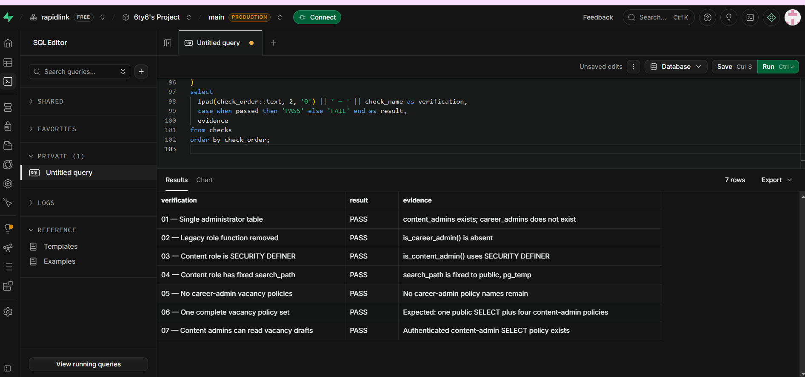
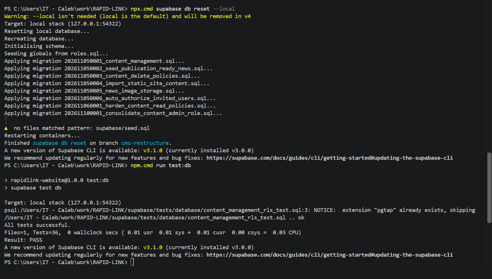
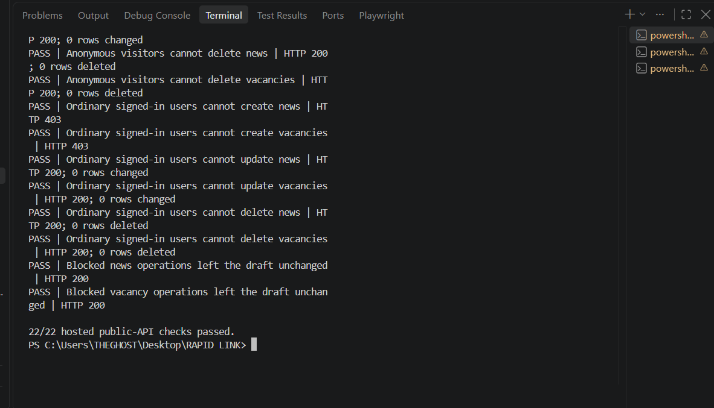

# RapidLink Website Follow-up Implementation Status Report

**Submitted to:** Edmund Nii Odoi Akogyeram, IT Officer  
**Prepared by:** Caleb Adom Awuah  
**Report date:** 10 November 2026  
**Project:** RapidLink Microfinance Website Redesign and Restructuring  
**Development branch:** `cms-restructure`  
**Production branch:** `main`

## 1. Purpose of this update

This report responds directly to the issues raised following the recent RapidLink website progress update. It records the work completed since that feedback, identifies the available verification evidence, and separates completed actions from work that remains dependent on technical decisions or approved departmental information.

The final six-page website review has been received and is being used as the controlling brief for the restructuring work. The loan calculator remains unchanged, and no unapproved pricing, regulatory or complaints wording has been invented or published.

## 2. Executive status

Substantial progress has been made on the security and governance concerns raised in the follow-up. The overlapping Supabase administrator models have been consolidated, the hosted migration has passed all seven structural verification checks, the reset local database suite has passed 36 of 36 tests, and the hosted public API has passed 22 of 22 role and write-protection checks using the public publishable key.

The production domain has been confirmed as `https://rapidlinkgh.com`. Page-specific social metadata has been implemented, the deployed demonstration service has documented security-header values, and the PDF preview dependency has been formally assessed.

The main outstanding deliverable is the CMS comparison due Friday, 13 November 2026. Further work also remains dependent on decisions about Supabase ownership and AWS, direct information from Credit and Compliance, approved Section 5 content, correction of preview-deployment headers, and a separate storage-upload security test.

## 3. Response to the follow-up issues

### 3.1 Production domain

**Issue raised:** Confirm the production domain.

**Work completed:**

- `rapidlinkgh.com` has been confirmed as the production domain.
- Canonical and social metadata records now use the confirmed domain.
- Page-specific absolute social-preview images have been configured for the homepage, About pages, Digital Channels and individual news stories.

**Work remaining:**

- Repeat canonical URL, social-preview, security-header and HTTP 404 checks after the final production deployment is active on `rapidlinkgh.com`.
- Confirm final DNS and hosting configuration during production cutover.

### 3.2 Supabase ownership and AWS consideration

**Issue raised:** The current free Supabase project is under “6ty6's Project”. Before launch it must be placed under a RapidLink-owned organisation or replaced by an approved AWS arrangement. This must be covered in the CMS comparison.

**Work completed:**

- The ownership and continuity risk has been recorded in the project handoff and implementation documentation.
- The CMS comparison requirements now explicitly include Supabase/Postgres compatibility, AWS compatibility, data location, backups, monitoring, maintenance responsibility, three-year cost and exit options.
- New custom content-management features have been paused until the comparison is reviewed.

**Work remaining:**

- Complete and submit the CMS comparison by Friday, 13 November 2026.
- Obtain a management decision on whether to transfer the hosted project into a RapidLink-owned Supabase organisation or adopt an approved AWS architecture.
- Complete any approved ownership transfer or infrastructure migration before production launch.

### 3.3 Consolidation of vacancy administrator policies

**Issue raised:** The vacancy implementation used overlapping `is_career_admin` and `is_content_admin` models. Career administrators could create vacancies but could not reliably read drafts. Both role functions also required verification as `SECURITY DEFINER` with a fixed `search_path`.

**Work completed:**

- Legacy career administrators were migrated into one `content_admins` role table.
- The legacy `career_admins` table and `is_career_admin()` function were removed.
- Vacancy policies now use the single content-administrator role for draft reads and create, update and delete operations.
- `is_content_admin()` is defined as `SECURITY DEFINER` with the fixed search path `public, pg_temp`.
- The hosted read-only verification returned **7 of 7 PASS**.
- The test administrator and ordinary authenticated user were independently confirmed to have the intended role assignments.

**Benefit:** RapidLink now has one understandable administrative authority model. This removes conflicting permissions and makes policy review, testing and future CMS integration safer.

### 3.4 Expanded security testing through the public API

**Issue raised:** Extend anonymous checks to update and delete, include a signed-in non-administrator, and execute the checks through the public API using the publishable key rather than relying only on the SQL editor.

**Work completed:**

- The reset local Supabase pgTAP suite passed **36 of 36 checks**.
- Anonymous create, update and delete restrictions are tested for both news and vacancies.
- A dedicated ordinary authenticated user is tested separately from the approved content administrator.
- The hosted runner uses the same public HTTP APIs and publishable key available to the website; it does not use a service-role key.
- The hosted public-API test passed **22 of 22 checks**.
- Blocked operations were confirmed to leave the protected draft records unchanged.
- A sanitized terminal-only screenshot was retained without passwords or access tokens.

**Work remaining:**

- Add a separate public-API test for anonymous uploads to the `news-images` storage bucket. The database and content-table API results must not be represented as proof of storage-bucket write protection.
- Re-run the security tests following any future policy or authentication change.

### 3.5 Loan calculator information from Credit and Compliance

**Issue raised:** Request the pricing method, rates, fees, APR wording and three Flexibank schedule examples directly from Credit and Compliance, copying Edmund.

**Work completed:**

- The calculator has deliberately not been changed.
- The required departmental questions and information dependencies have been documented.
- Existing automated tests protect the current calculator from accidental restructuring changes.

**Work remaining:**

- Send the formal information request to Credit and Compliance and copy Edmund.
- Obtain the approved pricing method, product-specific rates, fees, annual-rate and APR wording, and three representative Flexibank schedules.
- Validate future calculator results against the approved examples.
- Obtain Compliance approval before presenting the calculator as accurate or production-ready.

### 3.6 Items not covered in the earlier update

#### Social preview images

Page-specific absolute social-preview metadata has been implemented for key public pages and news stories. Final verification on `rapidlinkgh.com` remains a pre-production task.

#### AWS hosting question

AWS is being treated as an option rather than an assumed migration. The CMS comparison will assess the effect of AWS on hosting, database services, object storage, DNS, email, monitoring, backups, maintenance and three-year cost.

#### Section 5 customer-trust and regulatory information

Content models and ownership requirements have been prepared for complaints guidance, the fees schedule, the security centre, licensing and deposit-protection wording, privacy and related policy pages. Publication remains blocked until the responsible departments and Compliance provide approved information. No wording will be invented merely to fill the pages.

#### Final review document

The final six-page review has been received and has been used as the controlling guideline for the current implementation and work sequence.

### 3.7 Security headers and PDF preview dependency

**Security headers completed:** The actual production demonstration response values have been recorded for Content-Security-Policy, Permissions-Policy, Referrer-Policy, Strict-Transport-Security, X-Content-Type-Options and X-Frame-Options. The demonstration deployment achieved an **A+** result from SecurityHeaders.com.

**Security headers remaining:** The separate Render branch preview was observed without Content-Security-Policy, Permissions-Policy, Referrer-Policy and X-Frame-Options even though the repository configuration contains them. The preview service must be synchronized or corrected before its security evidence can be accepted. The checks must then be repeated on the final domain.

**PDF.js assessment completed:** The controller rate-guide viewer loads PDF.js only when the customer chooses to view the document. It does not form part of the normal homepage load, and the final recorded mobile Lighthouse performance score was 99. Direct PDF links previously downloaded automatically on some browsers and could not guarantee the requested view-before-download experience.

**Current decision:** Retain the lazy-loaded PDF.js viewer for the present controller guide. Reconsider it only after the final host has been tested across current desktop and mobile browsers.

## 4. Verification evidence

The following evidence is retained in the project repository:

- hosted role-consolidation verification: 7 of 7 PASS;
- local Supabase pgTAP verification: 36 of 36 PASS;
- hosted public-API verification: 22 of 22 PASS;
- administrator and ordinary-user role verification;
- SecurityHeaders.com A+ result and actual response-header values; and
- mobile Lighthouse results.

## 5. Work completed and work remaining summary

| Area | Current position | Remaining action |
|---|---|---|
| Production domain | Confirmed as `rapidlinkgh.com` | Verify final deployment, DNS, metadata, headers and 404 responses |
| Supabase administrator model | Consolidated and verified | Re-test after future policy changes |
| Local database security tests | 36/36 passed | Repeat after future migration changes |
| Hosted public-API tests | 22/22 passed | Add the separate storage-upload test |
| Social metadata | Page-specific metadata implemented | Verify on final production domain |
| Security headers | Production demonstration documented with A+ result | Correct and retest branch preview; retest final domain |
| PDF preview | Assessed; lazy-loaded viewer retained | Cross-browser validation on final host |
| CMS and infrastructure decision | Requirements documented | Complete CMS comparison and decide Supabase ownership or AWS direction |
| Loan calculator | Intentionally unchanged | Obtain and validate approved Credit and Compliance inputs |
| Complaints, fees, security and licensing content | Models and approval boundaries prepared | Obtain approved wording from responsible departments and Compliance |

## 6. Prioritised next actions

### Immediate — before Friday, 13 November 2026

1. Complete the two-to-three-page CMS comparison using current official sources.
2. Compare an existing-database administration layer, a self-hosted open-source headless CMS and a hosted/SaaS headless CMS, with an optional Git-based editor.
3. Provide a recommendation covering security, workflows, cost, maintenance, AWS compatibility, Supabase/Postgres fit and exit options.
4. Send the calculator-information request to Credit and Compliance, copying Edmund.

### Short term — before production approval

1. Decide and implement RapidLink ownership of the production data platform or an approved AWS alternative.
2. Add and retain evidence for the anonymous storage-upload security test.
3. Correct the missing headers on the Render preview and repeat the verification.
4. Verify canonical metadata, social previews, security headers and HTTP 404 handling on `rapidlinkgh.com`.
5. Select an approved production hosting plan; the free preview tier should not be treated as the final production arrangement.

### Dependent on departmental approval

1. Obtain the complete fees and charges schedule.
2. Obtain the approved complaints procedure and escalation timelines.
3. Obtain licensing and deposit-protection wording.
4. Obtain approved security-centre and fraud-reporting information.
5. Obtain and validate the calculator inputs and Flexibank examples.

## 7. Conclusion

The principal Supabase role and public-API security concerns raised in the follow-up have been addressed and verified. The work has remained isolated on the `cms-restructure` branch so that the current `main` production branch is not changed without review.

The project is not yet ready for final production approval. The CMS and infrastructure decision, storage-upload test, preview-header correction, calculator inputs and approved Section 5 information remain outstanding. These items have been separated clearly so that technical work can continue without presenting unconfirmed financial or regulatory information as approved.

---

**Prepared by:** Caleb Adom Awuah  
**Date:** 10 November 2026
