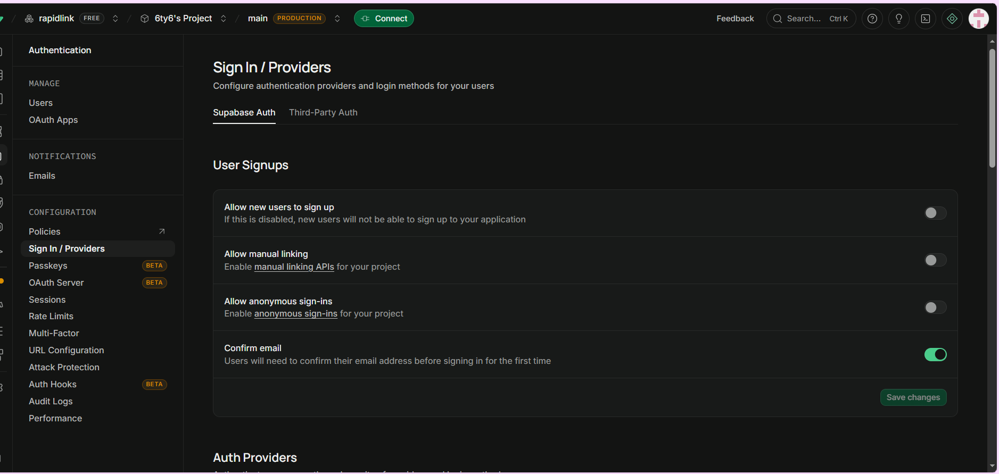
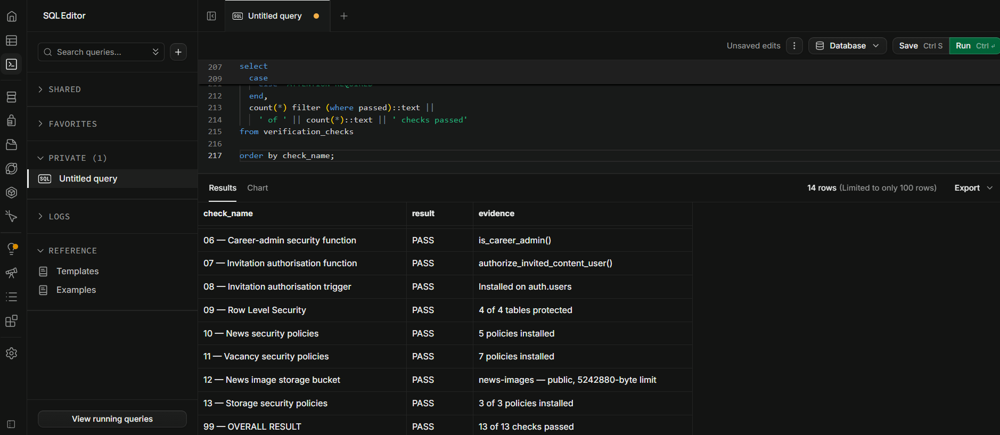
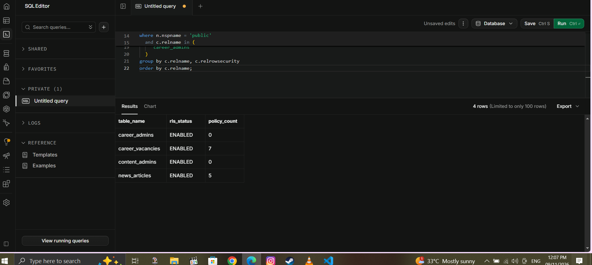
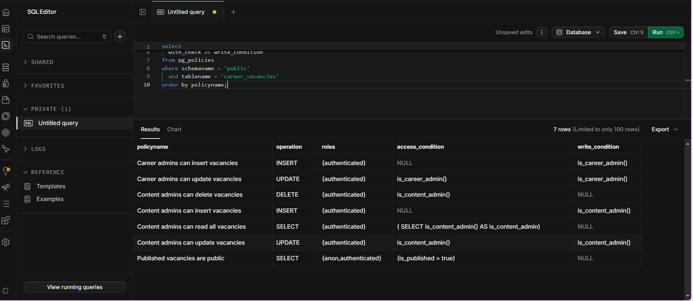
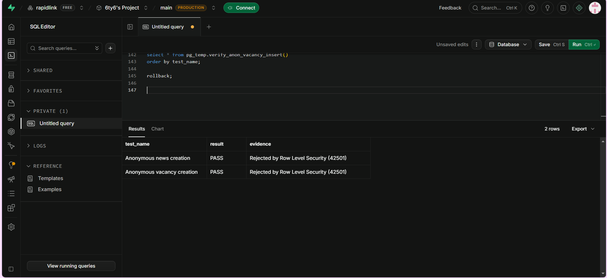
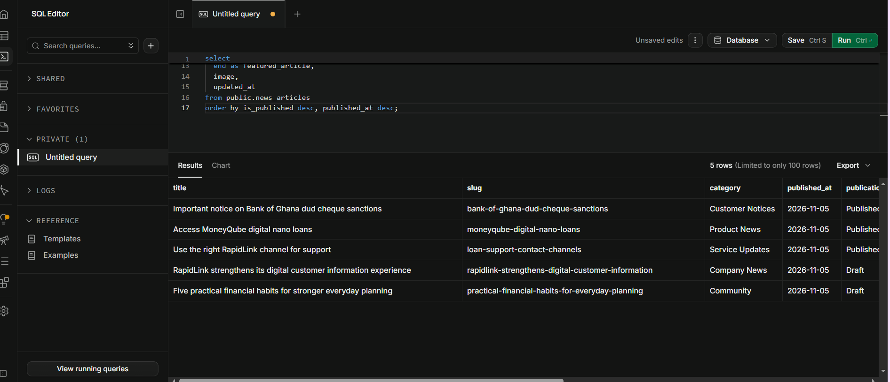
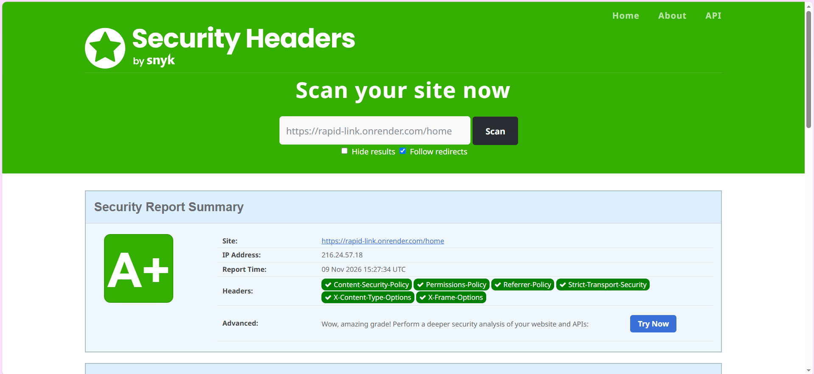

# RapidLink Website Restructuring and Technical Verification Report

**Submitted to:** Edmund Nii Odoi Akogyeram, IT Officer  
**Prepared by:** Caleb Adom Awuah  
**Report date:** 10 November 2026  
**Project:** RapidLink Microfinance Website Redesign and Restructuring  
**Development branch:** `cms-restructure`  
**Production branch:** `main`

## 1. Purpose of this report

This report provides a formal progress update following the website review dated 6 November 2026. It records the changes completed on the dedicated restructuring branch, explains how those changes respond to the review, presents the available technical evidence, and identifies the decisions and departmental information still required before production approval.

The restructuring work has deliberately been kept separate from the `main` production branch. This preserves the current demonstration version while allowing changes to be reviewed through a preview deployment before any approved merge.

## 2. Executive summary

The website has progressed from a mostly component-bound React prototype toward a more maintainable, testable and CMS-ready architecture. A structured content model, a single public content-access layer, pre-rendering, genuine HTTP 404 handling, security hardening and deployment verification have now been implemented on the `cms-restructure` branch.

The hosted Supabase project has also been checked. The supplied evidence confirms that public self-sign-up is disabled, Row Level Security is enabled on the relevant tables, published records remain publicly readable, administrative operations are restricted, and anonymous attempts to create news or vacancy records are rejected. The deployed preview received an **A+** result from SecurityHeaders.com.

On 10 November 2026, the current branch passed **53 of 53 automated tests**, completed a production build successfully and pre-rendered **26 public routes**. The build retains a non-failing PDF.js bundle-size warning, which is a later performance optimisation rather than a functional failure.

The loan calculator has not been altered. This follows the instruction to wait for the approved pricing method, product-specific rates, fees and Flexibank comparison examples from the Credit function. It must therefore remain recorded as an unresolved blocker and must not be represented as approved.

## 3. Work completed

### 3.1 Safe branch and preview workflow

Development is taking place on `cms-restructure`, while Render production remains connected to `main`. This gives RapidLink a controlled review process:

1. changes are developed and tested on the restructuring branch;
2. Render creates a separate preview for review;
3. evidence and stakeholder approval are collected; and
4. only approved work is merged into `main`.

**Benefit:** The public demonstration site is protected from unfinished restructuring work, and reviewers can inspect changes before production deployment.

### 3.2 Structured content models and governance

The project now contains a formal content-model specification and a current-content mapping. The models identify fields, proposed content owners, approvers, workflow states and security boundaries for content such as products, news, vacancies, people, rates, documents, navigation and organisational information.

Supporting documents include:

- `docs/rapidlink-content-models.md`;
- `docs/RapidLink Website Content Models - Caleb Adom Awuah.docx`;
- `docs/current-content-to-model-map.md`;
- `docs/content-access-layer.md`; and
- `docs/business-content-status.md`.

**Issue addressed:** Customer-facing information was previously mixed into presentation components, making ownership, approval and future CMS migration difficult.

**Benefit:** RapidLink can later change CMS technology without rewriting every public page, while departments retain clear responsibility for the information they own.

### 3.3 Single public content-access layer

Public pages now retrieve content through a stable repository interface rather than directly depending on a particular database or importing scattered storage-specific records. Local bundled content and existing Supabase news and vacancy records are exposed through the same public contract.

**Issue addressed:** Direct database or file dependencies inside page components would tightly couple the website to one implementation and make future migration expensive.

**Benefit:** The public website can continue working while the final CMS is evaluated. A future CMS adapter can replace the current source without forcing major changes to page layouts.

### 3.4 Editable content moved out of presentation components

The following content groups have been separated from React page presentation:

- official contacts, branches, social profiles and digital channels;
- homepage metadata, slides, quick links, featured products and news settings;
- Institutional Profile, Mission, Vision and impact statistics;
- Board of Directors records and biographies;
- shared footer and mobile-application promotion content;
- general page hero and SEO records; and
- downloadable-document metadata.

The React components still control layout, responsive behaviour, accessibility, animation and interaction.

**Benefit:** Approved wording and records can eventually be managed independently of visual code, reducing accidental design regressions when content is updated.

### 3.5 Pre-rendering and search readiness

The production build now generates complete HTML for public routes, including published news stories. The current verified build produced 26 pre-rendered public routes. Staff-only pages, invitation handling and the loan calculator retain the application shell.

**Issue addressed:** A browser-only single-page application can provide weak first-load content to search engines and social crawlers.

**Benefit:** Public pages have readable HTML, route-specific metadata and more reliable first rendering. This supports discoverability and gives a future CMS a clear rebuild-on-publish path.

### 3.6 Genuine HTTP 404 handling

The build creates a dedicated `404.html` and no longer relies on a wildcard success response for every unknown path. Known public routes and explicitly allowed application routes remain available, while missing pages, articles and assets return a real 404 response.

**Issue addressed:** A visually styled error page is not sufficient if the server incorrectly returns HTTP 200, because search engines may treat missing pages as valid content.

**Benefit:** Search engines, monitoring tools and customers receive the correct technical response, while the custom error experience remains consistent with the RapidLink design.

### 3.7 Supabase security hardening

Security migrations and verification material now cover:

- Row Level Security on public content tables;
- public read access limited to published news and vacancies;
- authenticated content-administrator access to drafts and management operations;
- restricted image-storage writes;
- deletion policies for managed content;
- invitation-based administrative authorisation; and
- explicit anonymous-write rejection tests.

The hosted evidence confirms four protected tables, five news policies and seven vacancy policies. Anonymous news and vacancy creation attempts were rejected with PostgreSQL error code `42501`.

**Benefit:** Visitors can read approved public content but cannot create, edit or delete content. Administrative access remains separate and auditable.

### 3.8 Security headers

The Render preview is configured with Content Security Policy, Permissions Policy, Referrer Policy, Strict Transport Security, X-Content-Type-Options and X-Frame-Options. The supplied SecurityHeaders.com scan awarded the preview an **A+** grade.

**Benefit:** These browser-level controls reduce exposure to cross-site scripting, clickjacking, unsafe framing, content-type confusion and unnecessary browser permissions.

### 3.9 Performance work completed

Performance improvements have been introduced without changing the approved page structure. These include locally served fonts, responsive image delivery, prioritised active-slide loading, deferred rendering of below-the-fold content and reduced image payloads.

The most recent supplied Lighthouse screenshot showed a mobile performance result of 69, accessibility 91, best practices 92 and SEO 69. A later incognito run shown during verification improved performance to 69 with the same displayed accessibility, best-practices and SEO scores. Further code changes and a separate downloaded audit were subsequently used during optimisation, but a final post-deployment Lighthouse screenshot has not yet been placed in `docs/evidence`. Therefore no higher score is claimed as final evidence in this report.

The SEO score on the Render preview is also affected by preview indexing controls. Final SEO verification must be repeated on the approved production domain.

## 4. Current verification results

| Verification item | Result | Status |
|---|---:|---|
| Automated unit and integration tests | 53/53 passed | Verified 10 Nov 2026 |
| Production build | Passed | Verified 10 Nov 2026 |
| Public routes pre-rendered | 26 | Verified 10 Nov 2026 |
| Hosted database deployment checks | 13/13 passed | Evidence supplied |
| Anonymous news creation | Rejected by RLS (42501) | Evidence supplied |
| Anonymous vacancy creation | Rejected by RLS (42501) | Evidence supplied |
| News security policies | 5 | Evidence supplied |
| Vacancy security policies | 7 | Evidence supplied |
| Public self-sign-up | Disabled | Evidence supplied |
| SecurityHeaders.com | A+ | Evidence supplied |
| Final post-change Lighthouse audit | Pending new screenshot | Outstanding evidence |
| Hosted real-404 response screenshot | Pending | Outstanding evidence |
| Render branch-preview settings screenshot | Pending | Outstanding evidence |

## 5. Evidence from the hosted environment

### 5.1 Authentication configuration

The hosted Supabase authentication screen shows that new public user sign-up and anonymous sign-in are disabled. Email confirmation remains enabled.

### 5.2 Database deployment verification

The hosted verification query reports 13 successful checks covering required tables, functions, triggers, RLS state, policy counts and image-storage configuration.

### 5.3 Row Level Security status

The hosted database confirms that RLS is enabled for the administrative and public content tables. The public content tables have five news policies and seven vacancy policies.

### 5.4 Vacancy access policies

The vacancy-policy evidence distinguishes public reads of published vacancies from authenticated administrative create, update, read-all and delete actions.

### 5.5 Anonymous-write protection

Both anonymous test inserts were rejected by Row Level Security with error code 42501.

### 5.6 Hosted news records and workflow states

The hosted database contains five news records: three published articles and two drafts. This demonstrates that public publication state is stored separately from draft content.

### 5.7 Security-header audit

The Render deployment achieved an A+ SecurityHeaders.com result, with all six reported controls present.

## 6. Requirements deliberately not completed

### 6.1 Loan calculator

The calculator remains unchanged. Before development resumes, RapidLink must provide:

- the correct pricing method for each relevant product;
- approved rates, fees, limits and repayment rules;
- at least three comparison examples from Flexibank schedules;
- approved annual-rate and APR disclosures; and
- approved wording that the result is an estimate and not an offer.

This is the highest-priority business blocker because an incorrect financial calculation could mislead customers and create regulatory and reputational risk.

### 6.2 Final CMS selection

The architecture is ready to connect to a future CMS, but the final product has not been selected. The separate comparison must evaluate at least:

- an administration layer over the existing Supabase/Postgres database;
- a self-hosted open-source headless CMS;
- a hosted software-as-a-service headless CMS; and
- optionally a Git-based editor.

The recommendation must cover roles, approval workflow, revision history, audit logs, previews, React/Postgres compatibility, AWS suitability, operations, security, three-year cost and exit options.

### 6.3 Production and governance approvals

The following remain necessary before production launch:

- departmental approval of regulated rates, fees, product wording and documents;
- approval of privacy and legal content before any personal-information form is introduced;
- confirmation of the final production hosting arrangement;
- final configuration and verification on `rapidlinkgh.com`;
- final mobile Lighthouse evidence;
- screenshot and response-header evidence for the hosted 404 page; and
- final review and approval before merging `cms-restructure` into `main`.

## 7. Recommended next sequence

1. Complete and submit the CMS comparison and recommendation.
2. Obtain Credit and Compliance inputs for the calculator and regulated financial information.
3. Capture the three outstanding screenshots listed in Section 4.
4. Review content owners and approvers with the relevant departments.
5. Select the CMS and implement only the approved adapter and workflow.
6. Repeat functional, accessibility, performance, security and 404 tests on the final domain.
7. Conduct management review of the preview deployment.
8. Merge to `main` and deploy only after written approval.

## 8. Conclusion

The restructuring branch now provides a stronger foundation for a public financial-services website. Content is more clearly governed, public pages are less dependent on storage technology, search and error handling have improved, and the hosted content system has evidence-backed access controls. The A+ security-header result and successful automated build provide useful assurance, but they do not replace business approval of financial content or the outstanding calculator validation.

The safest course is to preserve the current separation between development and production, complete the CMS decision, obtain the missing departmental information, and then move to final production verification in controlled stages.

---

**Prepared by:** Caleb Adom Awuah  
**Date:** 10 November 2026
