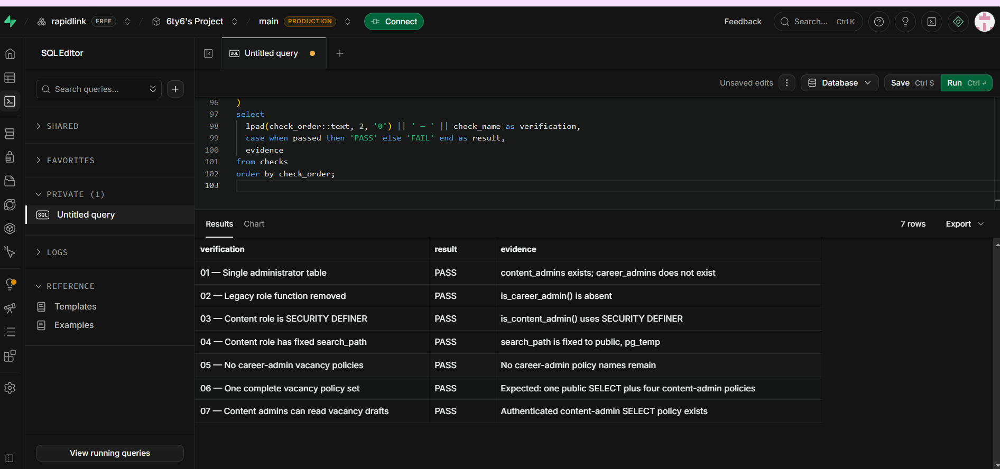
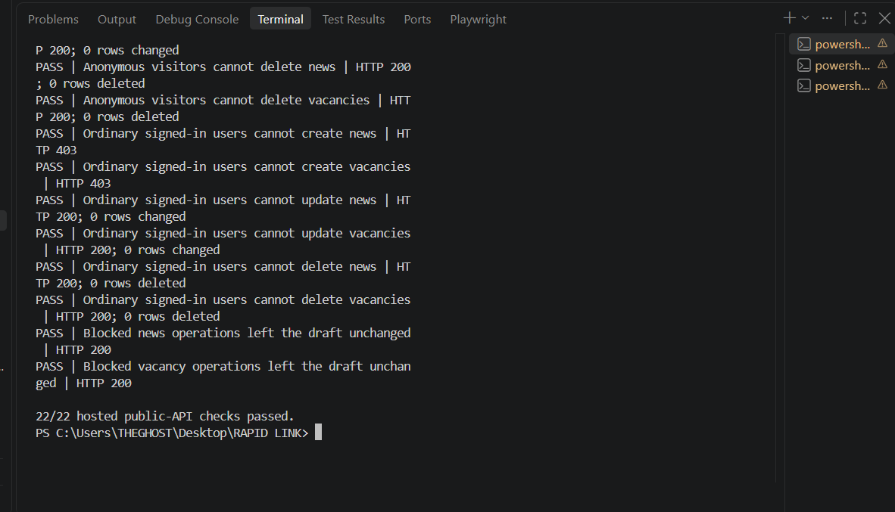
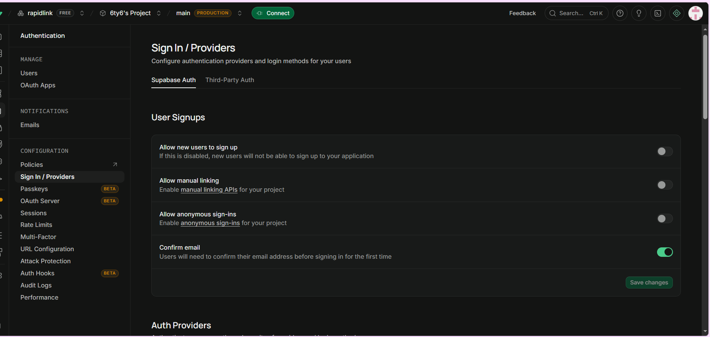
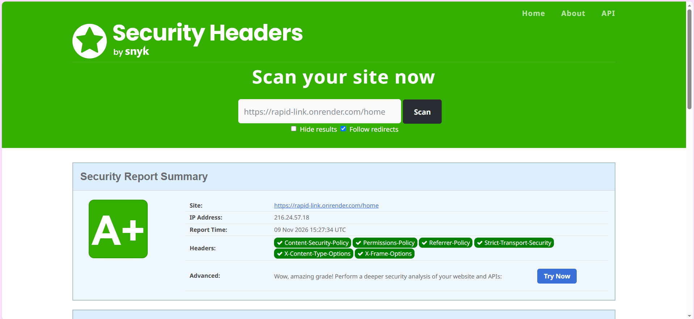
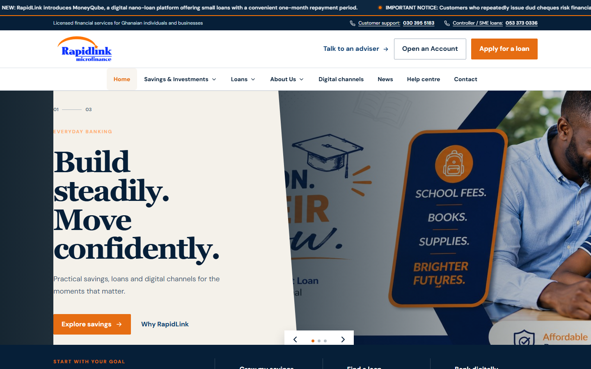
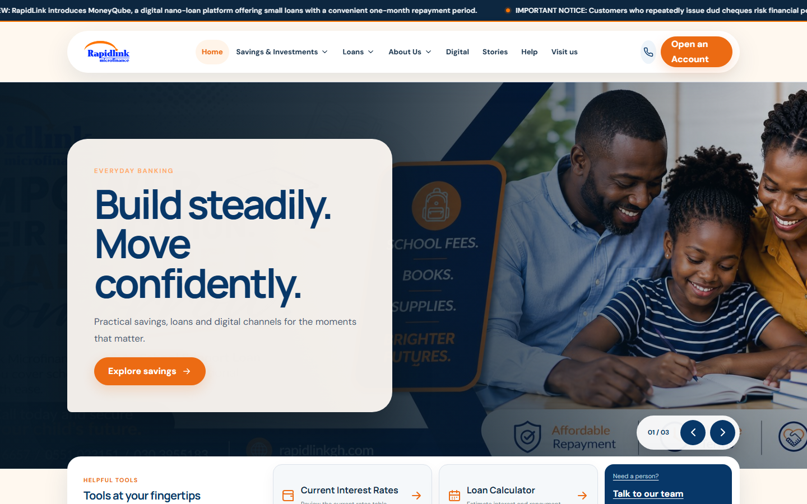
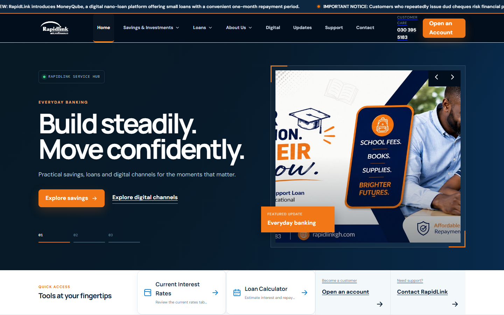
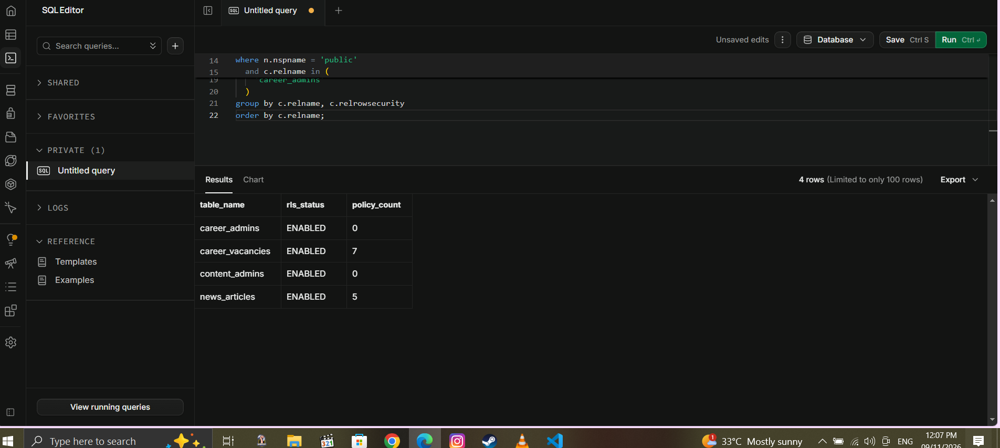
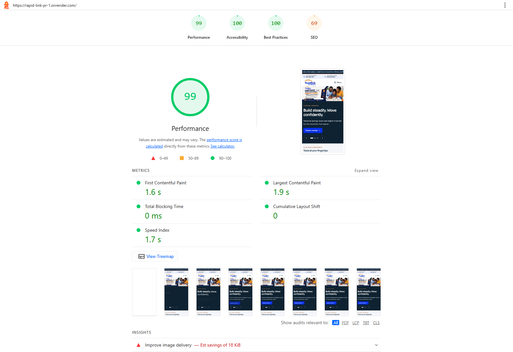

# RapidLink Website Project: Current Status, Verification and Design Options Report

**Submitted to:** Edmund Nii Odoi Akogyeram, IT Officer  
**Prepared by:** Caleb Adom Awuah  
**Report date:** 13 November 2026  
**Project:** RapidLink Microfinance Website Redesign and Restructuring  
**Document status:** Management progress report and decision brief  
**Development branch:** `cms-restructure`  
**Production branch:** `main`

This report records the current project position against the final six-page website review and Edmund's subsequent technical observations. It also introduces three new frontend design concepts requested by Owura and clearly separates completed implementation from work awaiting information, research or management approval.

<!-- pagebreak -->

# Table of Contents

[[TOC]]

<!-- pagebreak -->

# 1. Executive Summary

The RapidLink website project has progressed from a visual redesign into a controlled restructuring programme covering customer experience, content governance, security, search visibility, performance, deployment and future content-management options. The current work remains isolated from the `main` production branch so that demonstrations and research can proceed without changing the live production baseline.

The principal technical concerns raised by Edmund have been addressed or placed under explicit control. The production domain has been confirmed as `rapidlinkgh.com`; the overlapping Supabase career and content administrator models have been consolidated; hosted role verification passed seven of seven checks; the reset local security suite passed 36 of 36 checks; and the hosted public API test passed 22 of 22 checks using the public publishable key with separate administrator and non-administrator accounts. Page-specific metadata, a controlled PDF preview, HTTP 404 handling, security headers, prerendering and responsive navigation have also been implemented or formally assessed.

A subsequent directive from Owura required three materially different frontend designs for management comparison. Corporate Trust, Human-Centred and Digital First concepts were therefore developed on separate branches. Each uses the same approved information, routes, RapidLink colour identity and underlying functionality, but offers a different navigation model, homepage experience, content hierarchy and footer. Each concept passed 54 of 54 application tests and completed a production build that prerendered 26 public routes. None has been merged into `main`.

The loan calculator remains unchanged. Its required pricing method, approved rates, fees, annual percentage rate wording and validation schedules were not available because Isaac, the designated source for this information, was unavailable during the reporting period. Changing the calculator without those approved inputs would risk presenting incorrect financial information to customers.

CMS work has reached a substantial desk-research stage, but it is not complete for final selection or implementation. Owura's additional requirements expanded the intended information architecture and raised further questions about how future content, workflows and frontend variants should fit into the existing React, Supabase, prerendering and hosting model. Practical product trials, staff workflow tests, vendor quotations, restore exercises and management decisions are still required. The available research should therefore be treated as a decision-support draft, not as approval to purchase or deploy a CMS.

# 2. Project Background and Objectives

RapidLink requires a public website that functions as a credible advertisement for the institution while helping customers find products, current information, contact channels, branch directions and approved digital services. The redesigned platform must support the organisation's present microfinance operations and provide a maintainable foundation for possible future expansion into broader banking services.

The project objectives are to:

- present RapidLink as a trustworthy, customer-centred and regulated financial institution;
- make savings, investment, loan and digital-channel information easier to discover;
- improve mobile and desktop usability without creating separate content versions;
- provide controlled publication of news and future vacancies;
- prevent unauthorised users from creating, changing or deleting managed content;
- improve accessibility, security, search visibility and social sharing;
- support evidence-based management review before production changes are approved;
- avoid publishing unverified financial, legal, regulatory or complaints information; and
- retain a practical migration path if RapidLink later chooses a different CMS or hosting platform.

The work follows an iterative rapid-prototyping approach. Existing functionality is retained while selected components are restructured, demonstrated, tested and reviewed. This is appropriate because the website already exists, new requirements continue to emerge, and several future integrations depend on information or decisions outside the development team.

# 3. Scope, Governance and Change Control

## 3.1 Controlling documents

Edmund's final six-page review dated 6 November 2026 remains the controlling brief. The repository handoff, content models, implementation plan, security checklist and evidence records translate the review into technical tasks. The final six-page version has been received and used as the guideline for the current work sequence.

## 3.2 Branch isolation

Production continues to use `main`. Restructuring takes place on `cms-restructure`, and the three new designs are isolated on the following branches:

| Branch | Purpose | Current position |
|---|---|---|
| `main` | Stable production baseline | Not modified by the design comparison |
| `cms-restructure` | Shared restructuring, security and content-access work | Current integration baseline |
| `design/corporate-trust` | Formal institutional concept | Built, tested and awaiting comparison |
| `design/human-centred` | Customer-goal and story-led concept | Built, tested and awaiting comparison |
| `design/digital-first` | Modular digital-service concept | Built, tested and awaiting comparison |

This arrangement prevents experimental design work from disrupting the current site. Only the selected and approved concept should eventually be merged into `cms-restructure`, verified again and presented for approval before any change to `main`.

## 3.3 Information boundaries

The project does not invent financial or regulatory information. Loan pricing, current rates, fees, annual percentage rate wording, complaints timelines, licensing statements, deposit-protection wording, privacy terms and security guidance require written confirmation from the responsible department and Compliance before publication.

Customer applications, identification documents, complaints, balances, transactions and auditor-only financial reports are outside the public content-management scope. Annual reports and financial statements identified as auditor-only must not be placed in public assets or public CMS records.

# 4. Response to Edmund's Requirements

| Requirement raised | Work completed | Current status and remaining action |
|---|---|---|
| Confirm the production domain | `rapidlinkgh.com` is recorded in canonical and social metadata | **Completed for configuration.** Verify DNS, metadata, headers and 404 behaviour after final production deployment |
| Resolve Supabase ownership risk | Risk documented; CMS research includes ownership, AWS, backup, cost and exit considerations | **Decision required.** Move to a RapidLink-owned organisation or approve another architecture before launch |
| Consolidate vacancy administrator models | Removed the overlapping career-admin model and retained one `content_admins` authority model | **Completed and verified.** Repeat verification after future policy changes |
| Confirm role function security | `is_content_admin()` uses `SECURITY DEFINER` and fixed `search_path = public, pg_temp` | **Completed and verified** |
| Allow administrators to read vacancy drafts | A dedicated authenticated content-admin SELECT policy was added | **Completed and verified** |
| Extend anonymous update/delete checks | Anonymous create, update and delete restrictions are covered for managed content | **Completed** |
| Add a signed-in non-administrator | Separate administrator and ordinary-user accounts were used | **Completed** |
| Test through the public API and publishable key | Hosted API runner passed 22 of 22 checks without a service-role key | **Completed for content tables.** Storage-upload protection still requires a separate API test |
| Obtain calculator inputs from Credit and Compliance | Required information has been identified; calculator protected from accidental modification | **Awaiting information.** Isaac was unavailable and approved inputs were not received |
| Confirm the final six-page review | Final review received and used as the controlling brief | **Completed** |
| Implement social preview images | Page-specific absolute social metadata is available for key pages and stories | **Implemented.** Recheck cards on the final production domain |
| Address the AWS hosting question | AWS implications are included in CMS and infrastructure research | **Not decided.** AWS remains an option, not an authorised migration |
| Address complaints, fees, security centre and licensing information | Models, ownership questions and publication boundaries are documented | **Awaiting approved departmental and Compliance content** |
| Supply actual security-header values | Current Render demonstration values are documented; A+ external scan retained | **Completed for the demonstration host.** Repeat on `rapidlinkgh.com`; preview discrepancy still needs correction |
| Assess PDF.js | Lazy-loading, customer behaviour and performance impact assessed | **Retained for now.** Reconsider after final cross-browser testing |
| Compare CMS options | Directus, Strapi, Sanity, Contentful and Decap desk research prepared | **Partially complete.** Practical evaluation and expanded integration research remain outstanding |

# 5. Technical Work Completed

## 5.1 Content-management prototype

The current prototype provides a protected `/content-management` interface, invitation/password acceptance, authenticated news and vacancy management, publish/unpublish controls, deletion and news-image upload. Public pages read published content while approved administrators can work with drafts.

This prototype is useful for proving requirements, but it is not being treated as the automatic long-term CMS choice. New custom CMS expansion has been paused while the broader platform comparison and management requirements are completed.

## 5.2 Single administrator role and Row Level Security

The original vacancy implementation contained both `is_career_admin` and `is_content_admin`. This created overlapping authority and prevented a career administrator from reliably reading draft vacancies. The model was consolidated into one `content_admins` table and one security-definer role function with a fixed search path.

The unified policies provide:

- public read access only to published news and vacancies;
- administrator read access to drafts;
- administrator-only create, update and delete access;
- removal of legacy career-admin policy names and functions; and
- a simpler authority model for future review or CMS integration.

## 5.3 Hosted public-API security verification

The hosted verification used the same public Supabase HTTP interfaces and publishable key available to the website. It did not use a service-role key. Dedicated administrator and ordinary authenticated accounts were used alongside anonymous requests.

The 22 passing checks demonstrate that:

- anonymous users cannot create, modify or delete managed content;
- authenticated non-administrators cannot perform administrator writes;
- administrators can perform the permitted operations;
- blocked operations leave protected draft data unchanged; and
- public readers receive published content rather than administrative drafts.

## 5.4 Authentication and sign-up control

Public self-registration has been disabled. New staff access is based on an authorised invitation and password-creation process. The authentication configuration also requires email confirmation. The invitation flow alone is not the complete authority decision; database role policies remain the enforcement layer.

## 5.5 Search, social sharing and prerendering

Public routes are prerendered so that customers, search engines and social platforms receive meaningful HTML rather than an empty application shell. Twenty-six public routes are produced by the current build. Staff-only content management, invitation handling and the calculator remain SPA-only routes.

Page-specific metadata includes canonical URLs, descriptions and absolute social-preview images for key public pages and news stories. Preview deployments must remain non-indexable until management selects a final design and approves production release.

## 5.6 Security headers

The demonstration service response includes Content-Security-Policy, Permissions-Policy, Referrer-Policy, Strict-Transport-Security, X-Content-Type-Options and X-Frame-Options. The saved external scan achieved an A+ rating.

The scan applies to `rapid-link.onrender.com`, not yet to the final `rapidlinkgh.com` deployment. The branch preview was separately observed missing several configured headers. The preview service must be corrected and all headers must be rechecked on the final production domain before launch approval.

## 5.7 PDF viewing decision

The controller rate-guide viewer uses PDF.js only after a customer chooses to view the document. PDF.js is not part of the normal homepage load. Direct PDF links previously triggered downloads in some browsers rather than providing the requested view-before-download experience.

The current decision is to retain the lazy-loaded viewer until final-host cross-browser testing proves that a simpler direct link can meet the same customer requirement. The large PDF worker remains a build-size consideration and should be reviewed after deployment behaviour is known.

## 5.8 HTTP 404, navigation and responsive behaviour

The website includes a branded 404 experience, accessible navigation triggers, external-link safety, responsive headers, dropdowns that close appropriately and structured footers. Mobile layouts were checked separately from desktop layouts, including the homepage slider, navigation menus, product directories, application promotion and footer disclosures.

# 6. New Frontend Design Implementations Requested by Owura

## 6.1 Purpose of the new work

Owura requested three alternative frontend designs so management can compare different customer experiences before choosing a final direction. This was treated as new information and implemented without replacing the current website or changing business rules.

All concepts preserve:

- the RapidLink blue and orange identity;
- the same approved public information and routes;
- the existing Supabase and content-access security model;
- the unchanged loan calculator and financial disclosures;
- safe external-link behaviour;
- the same contact, news and product sources; and
- accessibility and responsive-design requirements.

## 6.2 Corporate Trust concept

Corporate Trust presents RapidLink as a formal and dependable financial institution. It uses editorial typography, strong alignment, structured product rows, a formal mega-navigation model and an institutional footer. The design gives priority to credibility, clear product comparison and management-approved information.

**Primary benefits:**

- strong institutional and regulatory impression;
- direct comparison of savings, loan and investment products;
- suitable for customers who expect a traditional financial-services layout; and
- clear separation between news, products, tools and corporate information.

**Consideration:** The design is information-dense and will require careful content editing to prevent lengthy pages.

## 6.3 Human-Centred concept

Human-Centred begins with customer goals and everyday financial needs. Rounded surfaces, approachable imagery, simpler language hierarchy and goal cards create a friendlier journey for customers who may not know a product name before visiting the website.

**Primary benefits:**

- makes product discovery easier for first-time or less technical customers;
- creates stronger emotional connection through customer-focused imagery;
- presents contact and branch information as part of the service journey; and
- provides a softer, more approachable interpretation of the RapidLink identity.

**Consideration:** Friendly visual treatment must remain balanced with the authority expected from a regulated institution.

## 6.4 Digital First concept

Digital First treats the website as a modern financial-service hub. It uses compact navigation, dashboard-inspired modules, high contrast, service shortcuts and a product index. It is intended to support customers who want to move quickly between digital channels, rates, calculators, account opening and contact support.

**Primary benefits:**

- efficient access to digital and self-service tools;
- contemporary presentation suited to future banking expansion;
- modular sections that can accommodate future services; and
- strong distinction between services, product comparison and information updates.

**Consideration:** Small supporting labels and dense modules require continued accessibility review as content grows.

## 6.5 Design verification and latest refinements

Each concept has its own header, dropdown behaviour, homepage slider, content hierarchy and footer rather than being a colour-only variation of the original site. Recent visual quality checks corrected heading-focus outlines, mobile text sizing and low-contrast action buttons. Representative home, Institutional Profile, loan, news and contact pages were checked at desktop and mobile widths for layout overflow.

| Concept | Latest branch commit | Automated tests | Production build |
|---|---|---:|---|
| Corporate Trust | `9c2b947` | 54/54 passed | Passed; 26 public routes prerendered |
| Human-Centred | `7c21f37` | 54/54 passed | Passed; 26 public routes prerendered |
| Digital First | `73e635b` | 54/54 passed | Passed; 26 public routes prerendered |

The three designs should next be scored against brand fit, customer clarity, accessibility, task completion, institutional credibility, marketing strength, maintainability and performance. Management should select one direction before complete page-by-page refinement continues.

# 7. Loan Calculator Status and Dependency

The loan calculator was not changed during this phase. This is an intentional risk-control decision rather than an omitted implementation.

The current calculator cannot be described as approved or production-ready until the following information is supplied and validated:

- the approved pricing and interest-calculation method;
- product-specific rates and permitted ranges;
- all applicable fees and charges;
- approved annual-rate and APR wording;
- repayment, rounding and date rules; and
- three representative Flexibank repayment schedules for comparison testing.

Isaac was identified as the person required to provide or coordinate this information. He was unavailable during the reporting period, so the necessary approved inputs could not be obtained. The existing calculator has therefore been protected from incidental changes while other restructuring work continued.

Changing the calculator through assumptions would create several risks:

- customers could receive an inaccurate repayment estimate;
- displayed results could conflict with approved product schedules;
- fees or annual-rate wording could be incomplete;
- development testing would have no authoritative expected results; and
- RapidLink could publish financial information that has not passed Credit and Compliance review.

**Required next action:** obtain the information from Isaac or an authorised Credit and Compliance delegate, copy Edmund into the request and follow-up, convert the three schedules into acceptance tests, implement the approved method, and obtain formal review before wider demonstration.

# 8. CMS Research Status

## 8.1 Work completed

Desk research has compared Directus, Strapi, Sanity, Contentful and Decap. It covers editor workflows, permissions, audit considerations, hosting models, Supabase/Postgres fit, AWS implications, data location, backup and recovery responsibilities, indicative three-year costs and exit considerations. A full research report, management summary, cost worksheet and test matrix exist in the repository.

The initial shortlist identifies Directus as a possible SQL-continuity candidate, Sanity as a managed-backend candidate and Strapi as a self-hosted alternative. This shortlist is preliminary and does not constitute product approval.

## 8.2 Why the research is not complete

Owura's additional direction introduced broader design and information requirements that require further investigation before deciding how a CMS should fit the system. The selected CMS must support not only news and vacancies but also an expanding mix of product information, customer guidance, regulatory material, images, future campaigns and potentially new banking-oriented services.

The final decision also depends on matters that desk research alone cannot prove:

- the number and responsibilities of editors, reviewers and publishers;
- whether departments require separated access;
- whether self-approval must be prevented;
- MFA, SSO and session-control requirements;
- audit-log and revision-retention periods;
- permitted data locations;
- integration with the selected frontend concept and prerendered publishing;
- recovery of content, media, configuration and permissions;
- staff usability with real but synthetic workflows;
- vendor quotations, renewal terms and usage growth; and
- the final decision between RapidLink-owned Supabase and a possible AWS arrangement.

All practical scenarios in the current personal CMS test matrix remain **NOT RUN**. No final vendor quotation, staff demonstration or restore exercise has been completed. Consequently, the CMS work should be reported as substantial preliminary research with the final comparison, practical validation and system-fit decision still outstanding.

## 8.3 Recommended completion process

1. Confirm the expanded content list and approval owners after the design direction is selected.
2. Confirm editor count, department boundaries, approver roles, MFA/SSO needs, audit retention, permitted region and budget.
3. Trial a limited shortlist with synthetic content and separate writer, approver and administrator accounts.
4. Verify that writers cannot publish, public clients cannot read drafts, and the approved public version remains stable during draft editing.
5. Test preview, Render rebuild, failed-build notification, account revocation, export and clean-environment restoration.
6. Obtain dated vendor quotations and calculate full three-year operating cost, including maintenance and infrastructure.
7. Present the evidence, risks and recommendation to Edmund and management before purchase or migration.

# 9. Quality, Security and Performance Evidence

## 9.1 Application and build verification

The shared application test suite contains 54 tests. Each of the three new design branches passed the full suite. Each production build completed successfully and prerendered 26 public routes. This confirms that the new visual structures did not remove the existing content, application flows or route generation covered by the tests.

## 9.2 Database verification

The reset local Supabase pgTAP suite passed 36 of 36 checks. Hosted structural verification passed seven of seven checks. The hosted API suite passed 22 of 22 checks. These results are complementary: structural SQL evidence does not replace public-API evidence, and content-table evidence does not prove storage-bucket protection.

## 9.3 Lighthouse result

The final retained mobile Lighthouse evidence records strong accessibility and best-practice results and a substantially improved performance result. Lighthouse scores are measurements under a particular environment and should be repeated on the chosen design and final production domain.

## 9.4 Remaining verification gaps

- Run a separate public-API test proving anonymous users cannot upload to the `news-images` storage bucket.
- Correct and repeat the missing security-header checks on the Render branch preview.
- Repeat security headers, metadata, 404, Lighthouse and social-card checks on `rapidlinkgh.com`.
- Run accessibility and user-task testing on the selected design rather than maintaining three full production candidates indefinitely.
- Validate the calculator only after approved schedules become available.

# 10. Outstanding Section 5 and Business Information

The following website areas remain dependent on approved source information:

| Information area | Required owner or approval | Current handling |
|---|---|---|
| Complaints procedure and escalation timeline | Customer Service, management and Compliance | Do not invent timelines; retain contact route only |
| Complete fees and charges schedule | Product owners, Credit and Compliance | Await approved schedule and effective date |
| Security centre and fraud guidance | IT/Security, Operations and Compliance | Await approved reporting channels and wording |
| Licensing and deposit-protection statement | Legal/Compliance and management | Await exact approved regulatory wording |
| Privacy, terms, cookies and accessibility statements | Legal/Compliance | Models may be prepared; publication requires approval |
| Branch opening hours and holiday notices | Operations | Await verified branch information |
| Downloadable forms and KYC checklists | Product owners and Compliance | No current approved materials supplied |
| Current vacancies | Human Resources | No new vacancy is confirmed; future publication requires HR approval |

The website can safely prepare structures, ownership fields and approval workflows for these areas, but it should not fill them with assumed content.

# 11. Risks, Dependencies and Management Decisions

| Risk or dependency | Potential impact | Recommended response |
|---|---|---|
| Supabase project remains in a personal/free organisation | Ownership, continuity and support risk before launch | Transfer to a RapidLink-owned organisation or approve an alternative architecture |
| No final CMS decision | Continued dependence on prototype administration and developer support | Complete practical shortlist tests and management decision gates |
| Calculator inputs unavailable | Incorrect customer estimates if changed without authority | Keep unchanged until Isaac or an authorised delegate supplies approved inputs |
| Section 5 content unavailable | Incomplete customer-trust and regulatory information | Assign departmental owners and written approval dates |
| Three designs remain active too long | Duplicate maintenance and inconsistent refinements | Score and select one direction before full completion |
| Preview security headers differ from configuration | Preview evidence may be misleading | Synchronise/redeploy Render preview and rerun direct header checks |
| Storage upload not yet API-tested | Database evidence could be overstated | Run a dedicated anonymous/admin storage test |
| PDF worker is large | Build-size and maintenance cost | Retain lazy loading; reassess after final-host browser tests |
| Free Render tier used as production | Availability and operational limitations | Select an approved production plan before launch |

The immediate decisions requested from management are:

1. select or shortlist one of the three frontend concepts;
2. confirm whether Supabase will be moved into a RapidLink-owned organisation or whether an AWS alternative must be designed;
3. identify the decision makers and practical-test participants for the CMS evaluation;
4. nominate an authorised substitute if Isaac remains unavailable for calculator inputs; and
5. assign owners and approval dates for complaints, fees, security and licensing information.

# 12. Recommended Work Plan

## 12.1 Immediate actions

1. Present the three design concepts and record a scored management decision.
2. Obtain the calculator information from Isaac or an authorised delegate, copying Edmund.
3. Complete the separate storage-upload public-API security test.
4. Correct and retest the Render preview security headers.
5. Confirm the expanded CMS requirements introduced by Owura.

## 12.2 Short-term actions before production approval

1. Run practical CMS trials using synthetic data and separate staff roles.
2. Obtain vendor quotations and complete the three-year cost comparison.
3. Decide the production data-platform ownership and hosting model.
4. Complete the selected frontend design across the approved page inventory.
5. Obtain and publish only approved Section 5 content.
6. Run accessibility, performance, security, metadata and user-acceptance testing on the selected design.

## 12.3 Production readiness actions

1. Merge only the approved design into `cms-restructure` and rerun the full tests and build.
2. Obtain formal approval before merging into `main`.
3. Configure the final production plan, DNS and environment variables.
4. Verify `rapidlinkgh.com` directly for HTTPS, security headers, canonical URLs, social cards, sitemap, robots directives, 404 behaviour and public content.
5. Record rollback, backup, monitoring and operational ownership before launch.

# 13. Conclusion

The project has made material progress in four areas: customer-facing restructuring, controlled content administration, security verification and management-ready design comparison. The principal Supabase role conflict identified by Edmund has been resolved and verified, and the hosted public API has passed role-based write-protection checks. The three new frontend concepts requested by Owura have also been implemented safely on isolated branches and verified against the existing application suite.

The project is not yet ready for final production approval. The loan calculator remains correctly on hold because approved information was unavailable from Isaac. CMS work has produced valuable desk research but requires further system-fit research and practical testing following Owura's expanded requirements. Supabase ownership, the production hosting plan, storage testing, final security-header verification and approved Section 5 information also remain open.

The recommended next management action is to select a preferred design direction, confirm ownership and CMS decision requirements, and unblock the departmental information dependencies. This will allow the project to move from controlled prototype and evidence gathering into a single, supportable production implementation.

<!-- pagebreak -->

# Appendix A. Evidence Register

| Evidence item | What it supports | Location |
|---|---|---|
| Consolidated Content Role Verification | Single administrator table, removed legacy role, security-definer function and complete vacancy policies | `docs/evidence/Consolidated Content Role Verification - PASS.png` |
| Hosted Public API Security Tests | Administrator, non-administrator and anonymous content-table behaviour | `docs/evidence/Hosted Public API Security Tests - 22 of 22 PASS.png` |
| Authentication evidence | Disabled public sign-up and authentication settings | `docs/evidence/auth evidence.png` |
| Local RLS verification | Reset local database suite passing 36 of 36 checks | `docs/evidence/Local RLS verification tests pass.png` |
| Security-header evidence | External scan and direct header verification for the Render demonstration service | `docs/evidence/header test.png` and `docs/security-header-verification.md` |
| Lighthouse summary | Mobile performance, accessibility, best-practice and SEO measurements | `docs/evidence/Lighthouse Mobile Performance Summary.png` |
| Frontend concept screenshots | Visual comparison of Corporate Trust, Human-Centred and Digital First | `docs/evidence/Design Concept - *.png` |
| CMS research | Official-source desk research, costs, risks and decision gates | `docs/cms-research-report.md` and management summary |
| PDF preview assessment | Reason for retaining lazy-loaded PDF.js | `docs/pdf-preview-assessment.md` |

# Appendix B. Deliverables and Supporting Records

- `docs/CODEX_HANDOFF.md` — current project handoff and controlled work sequence.
- `docs/frontend-design-variants.md` — design-branch purpose, comparison scope and acceptance checklist.
- `docs/rapidlink-content-models.md` — proposed structured public-content models.
- `docs/current-content-to-model-map.md` — relationship between existing content and future models.
- `docs/cms-research-report.md` — full desk-research comparison.
- `docs/cms-management-summary.md` — management-level CMS summary.
- `docs/cms-personal-test-matrix.csv` — practical evaluation scenarios, currently not run.
- `docs/security-header-verification.md` — direct header values and preview discrepancy.
- `docs/pdf-preview-assessment.md` — PDF.js decision record.
- `supabase/verification/verify_consolidated_content_role.sql` — hosted read-only role verification.
- `tools/verify-hosted-content-api.mjs` — hosted public-API role and write-protection verification.

---

**Prepared by:** Caleb Adom Awuah  
**Submitted to:** Edmund Nii Odoi Akogyeram  
**Date:** 13 November 2026
